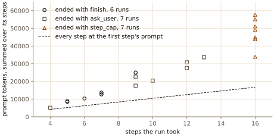

# Trace each run and count what it cost

By the end of this chapter, you can make every run write one record per step to a file that a later reader can parse, give each record IDs that tie it to its run and its call, and say what the run cost in tokens. Cost here means counts. It never means money.

The maintenance agent makes its runs on `unitcraft` in a scratch copy. A run can end well, badly or not at all, and its [stop reason](#ways-to-end) says only how it ended. Take the [chapter 1](#tools-and-a-loop) run on T-01, one of the tasks in the task set. It reads the right file and runs the tests, then makes a string of malformed calls until it reaches the step cap. The stop reason reads `step_cap`, and that is all the stop reason says. It does not say what the malformed calls had in common, what the harness did with each one, or how many tokens each step used. Those answers sit in the steps, so the harness has to keep the steps.

The record of each step is the trace. [Chapter 10](#testing-the-agent)'s score already reads the stored counts, and a reader who asks why a run stopped needs the steps before the stop. This chapter writes the trace as data, gives its IDs a fixed form, and counts what it holds. Every count in this chapter is read from a recording or printed by a script, and none is taken from a live model, so the counts are stored counts, and the one check that would re-derive them from the model has not been run.

## One line per event {#one-line-per-event}

A trace is a file with one JSON object per line. The format has a name, JSON Lines, and a short definition: each line holds one JSON value, the file is UTF-8, and a line feed ends each line. The page recommends a line feed after the last line as well, but does not require one, and it also accepts a carriage return and a line feed. The [JSON Lines format](https://jsonlines.org/) says that a byte order mark must not be included. The harness writes each record with sorted keys, no spaces and ASCII only, so the same record always comes out as the same bytes. That matters for the same reason the printed output matters: a reader can compare two traces line by line.

Replaying the [chapter 1](#tools-and-a-loop) run on T-01 writes its steps in this form. The replay reads the recorded reply for each step, so the trace is the same on every run.

[Example: trace-one-run](../examples/trace-one-run.py)

The run has {{out:trace-one-run:records}} records, one for each of its steps, and its last record carries the stop, `step_cap`. Each record holds the step number, the tool, the arguments, a one-line brief of what came back, a result class, the call IDs, the tools that were offered, the gate's lines for that step and the token counts for that step. The first call's ID is {{out:trace-one-run:first call ID}}.

The later steps are malformed calls. The model's reply was not valid JSON, so the harness did not run the call. It recorded the step as `refused`, and it put the parse error in the `malformed` field. `refused` covers every call that the harness did not run, or that a tool turned away before it ran: a reply that cannot be parsed or was cut off, a tool name the harness does not offer, arguments that do not fit the tool, a change a gate holds, and a path that a tool's own check refuses. The third class, `error`, is different. It means a tool ran and reported a failure. Reading `refused` as a tool error sends a reader to look for a bug in a tool that was never called.

Summed over the records, the replayed run used {{out:trace-one-run:prompt tokens, summed over the records}} prompt tokens and {{out:trace-one-run:completion tokens, summed over the records}} completion tokens. Those are the counts the recording stored for each step, not counts taken during the replay.

The file has one trap, and the example shows it at the end. JSON Lines does not allow a blank line, because a blank line is not a value. Parsing an empty line fails, and Python reports it as {{out:trace-one-run:blank line}}. Its records go to a file and come back through a reader. Splitting the text on line feeds leaves one empty piece after the last line feed, so the reader skips that piece on purpose and counts it. Here {{out:trace-one-run:lines read back}} records come back, and {{out:trace-one-run:empty pieces skipped}} piece is skipped. A reader that did not skip it would stop at the end of every file.

**Working rule:** A reader of a trace skips an empty line only on purpose, and it counts the lines it skipped. Otherwise it stops at the first empty line. The writer never adds a blank line between records.

## IDs without clocks {#ids}

A step in a trace has to be found again, by the run it belongs to, by the call it answers and by its place in order. The trace takes its IDs from counters passed in by the caller, and from nothing else. A run is `run-0001`, numbered from one. A tool call is its run's ID with `c` and a number, so the first call of that run is `run-0001-c1`, the same ID that the first record of the replayed run carries. Steps are numbered from 1 in the order they happened.

No record carries a time. A timestamp would be different on every run, and so would the printed output of any example that showed it. Each example is compared with the output it printed when it was recorded, so a timestamp would fail that comparison on every run. The trace holds counts, short results and IDs, and nothing that comes from a clock.

The IDs matter for a second reason. Run IDs and call IDs go into the requests the harness sends to the model, so a replay sends the same request as the recording only when it numbers its runs the way the recording did. The replay code for a task picks up its counter at that task's place in the recording, which is why [the child example](#child-records) numbers its run from the recording's order and not from its own start.

**Working rule:** Number runs and calls from a counter passed in, never from a clock or a random generator. An ID that changes between runs changes the request, and a replay of that run stops at the first request it cannot match against the recording.

## Tokens as counts {#token-counts}

Each record in the [trace](#one-line-per-event) carries two token counts, in the pinned model's tokens as [chapter 1](#what-goes-wrong) defines them. The prompt count is the tokens the model read, and the completion count is the tokens it wrote. The recording takes both counts when it runs. It stores each step's counts with its reply, in `replies.jsonl`, and each task's totals in its manifest. Replay reads the stored counts and never tokenizes again, so a replay cannot produce a count the recording did not write.

Summing the stored step counts per task, and for the set, is the job of the next example. It checks each task's sums against the totals the manifest stores for that task, and it checks the set's prompt sum against the sum of those task totals.

[Example: token-counts-from-recording](../examples/token-counts-from-recording.py)

Every task's sums agree with its manifest, so the set's totals below are the recording's own counts. The task set has {{out:token-counts-from-recording:set tasks}} tasks, which together used {{out:token-counts-from-recording:set prompt tokens}} prompt tokens and {{out:token-counts-from-recording:set completion tokens}} completion tokens. The output's live count check, which would tokenize the recorded prompts with the pinned model, reports {{out:token-counts-from-recording:live count check}}.

The library's source shows how a count of this kind is produced. llama-cpp-python's source was read at the release that the recordings pin, and it was not run here. Its non-streamed completions report the length of the prompt's token list and of the completion's token list, and their sum as the total ([llama.py at v0.3.36](https://raw.githubusercontent.com/abetlen/llama-cpp-python/v0.3.36/llama_cpp/llama.py)). Its `tokenize` method takes UTF-8 bytes and returns a list of integer token IDs. It adds a beginning-of-sequence token unless it is told not to, so a prompt's count depends on that setting as well as on the model's vocabulary.

Counts from different tokenizers are not comparable. This is a rule of thumb, not a measurement: a token is a unit of one vocabulary, and the same text can split into different numbers of units under another. A reader who compares two counts must first check that the model file and the settings match.

The recording's manifest stores the model file and its SHA-256, but not the settings that shape a prompt's count: the chat template that the library applied, and the beginning-of-sequence setting. The recording used the library's defaults for both, and the book does not yet write them down.

**Working rule:** Store each count with the model file it came from, and with any setting that changes it, such as the beginning-of-sequence token. Do not compare counts from different tokenizers. A count that no check has re-derived is reported as a stored count, never as a live one.

## A child's records sit under its parent's call {#child-records}

[Chapter 8](#subagents-and-handoffs) hands a subtask to a child loop and gets back a summary and a stop reason. It also keeps the child's own record with the child, so that the parent's summary is not the only trace of what happened. This section keeps that promise in the trace. A child's steps are written as their own run, with their own run ID and their own call IDs. Each of its records carries `parent`, the ID of the call that started it. The child's records print directly after the parent's call that started them.

Here a parent starts a child on T-04, a task that asks for an inch unit. The child's recorded run ends with a finish that changes files. A scripted person says no to that change, so the gate holds the finish, and the child hands back with a question.

[Example: child-trace-under-parent](../examples/child-trace-under-parent.py)

The child's run takes the number that the recording gave T-04, the fourth run in it, so its requests match the recorded ones. The run is {{out:child-trace-under-parent:child run}}, and its first record names the parent's call in `parent`: {{out:child-trace-under-parent:parent call of the child}}.

The child's records carry the counts the recording stored for T-04, {{out:child-trace-under-parent:child prompt tokens, summed}} prompt tokens and {{out:child-trace-under-parent:child completion tokens, summed}} completion tokens, which the script asserts against the manifest. The parent is scripted, so its records carry no tokens: {{out:child-trace-under-parent:parent tokens, summed}}.

The person's no is where the child's run ends. The gate holds the finish at step {{out:child-trace-under-parent:held step}}, the child's last record, and the child hands back a question instead.

The child stops with {{out:child-trace-under-parent:child ended}}, and the gate refused {{out:child-trace-under-parent:gate refusals}} call. That stop comes from the gate, not from the budget of {{out:child-trace-under-parent:child budget}} steps. The parent, which is also scripted, asks the person a question of its own and stops with {{out:child-trace-under-parent:parent ended}}. The library copy is unchanged after the run, which is the whole point of the gate: the held change never reached the library.

This example does not show a child that runs out of budget. [Chapter 8](#subagents-and-handoffs) covers that case, and its stop reason comes from the budget, not from a held change.

**Working rule:** Give each child its own run ID and its own records, each with `parent` set to the call that started it. When you report what a parent run cost, add its children's counts and say that you did so. This trace prints them apart and sums none of them into the parent.

## Cost as counts, not money {#cost-not-money}

With the stored counts [summed per task](#token-counts), a run's cost is three numbers: its steps, its tool calls and its tokens. This book reports those three and nothing else. A price table goes stale, and a figure in dollars stays wrong after the first price change, so the book does not multiply its counts by a price. A reader who needs dollars can multiply the counts by the price their provider charges today, and the book's numbers stay right when prices change.

Grouping the stored counts by how each run ended puts the step-capped runs beside the others, so the cost of each stop reason shows in the same output.

[Example: cost-as-counts](../examples/cost-as-counts.py)

The step-capped runs took {{out:cost-as-counts:step-capped runs, steps}} steps and {{out:cost-as-counts:step-capped runs, prompt tokens}} prompt tokens. The line for the step-capped runs reads {{out:cost-as-counts:ended step_cap}}. The line for all the runs reads {{out:cost-as-counts:all}}, and it covers every group above it. A further assertion checks the recording: every run made one tool call per step, so the tool-call counts and the step counts are the same number.

None of the step-capped runs is done: the count reads {{out:cost-as-counts:step-capped runs done}}. A step-capped run ends with neither a `finish` nor a handoff, so the zero follows from [the done rule](#score) whatever its files hold. The ask_user group's one done is T-18, whose count comes through a path match ([chapter 10](#t18-path)). The zero says nothing about how close any step-capped run came, and this chapter does not read it as a finding about the tasks.

Judgement, not a measurement: the step-capped line is the cost of runs that spent their tokens and did not finish. A token budget on the run's total tokens, not the per-request prompt budget of [chapter 5](#context-budgets), would have stopped those runs sooner. Its price is the chance of stopping a run that would have finished on a later step, and this recording cannot show that chance, because each step-capped run stopped at the cap and wrote no later step. The prompt count is what makes the cost grow: the loop sends the whole transcript again at every step. Counting the step-capped runs whose prompt count rises at every step gives {{out:cost-as-counts:step-capped runs whose prompt count rises at every step}}. A step budget counts steps, so for a long run it says less about the cost than the tokens do. If a token budget is set, the harness should end the run with its own stop reason and its own counts, so that a cut by the budget can be told apart from a cut by the step cap.

{{fig:tokens-against-steps}} draws each recorded run as one point, with its steps along the bottom and its prompt tokens, summed over the run, up the side. The marker shape shows how the run ended: hollow circles ended with a `finish`, hollow squares asked the person, and hollow diamonds hit the step cap. The {{out:figure-tokens-against-steps:step-capped runs}} diamonds stand in one column at the cap of {{out:figure-tokens-against-steps:step cap, in steps}} steps, and every one of them is higher than any run that ended another way: the lowest of them totals {{out:figure-tokens-against-steps:lowest prompt total, step-capped runs}} prompt tokens, and the highest of the others {{out:figure-tokens-against-steps:highest prompt total, other runs}}.

[Example: figure-tokens-against-steps](../examples/figure-tokens-against-steps.py)

The dashed line is what a run would cost if every step sent only the first step's prompt, {{out:figure-tokens-against-steps:mean first-step prompt, in tokens}} tokens on average. {{out:figure-tokens-against-steps:runs above the dashed line}} runs sit above it, because every step's prompt carries the steps before it, as [the prompt at each step](#where-tokens-go) in chapter 5 shows. The step-capped runs average {{out:figure-tokens-against-steps:prompt tokens per step, step-capped runs}} prompt tokens a step, and the other runs {{out:figure-tokens-against-steps:prompt tokens per step, other runs}}.

So the step-capped runs carry more of the cost than their steps suggest: {{out:figure-tokens-against-steps:step-capped share of steps}} of the steps, but {{out:figure-tokens-against-steps:step-capped share of prompt tokens}} of the prompt tokens.

[Chapter 12](#when-an-agent-is-the-wrong-design) compares an agent with a [fixed pipeline](#fixed-pipeline-first) in these same units, and the units are only useful if every run reports them the same way.

**Working rule:** Report a cost as the steps, tool calls and tokens of each run, grouped by how it ended, with the groups printed beside each other. Quote no money. Read a step-capped group as tokens spent without a finish, and not as evidence about the task until a second measure says otherwise.

## Keep your own field names, and map them at the edge {#own-fields}

The record's token fields are `prompt_tokens` and `completion_tokens`, and they are the book's own. The OpenTelemetry project publishes conventions for telemetry from generative AI systems. Its GenAI spans page, in revision v1.37.0 of the semantic conventions, names the same two counts `gen_ai.usage.input_tokens` and `gen_ai.usage.output_tokens` ([the semantic conventions, GenAI spans](https://raw.githubusercontent.com/open-telemetry/semantic-conventions/v1.37.0/docs/gen-ai/gen-ai-spans.md)). In that revision the page marks its status as "Development", so the names may change. The book does not use OpenTelemetry. The [token-count example](#token-counts) prints the two names beside the book's fields, as data only, and this chapter makes no claim about how an OpenTelemetry tool reads a trace.

The book keeps its own names for a practical reason. A reader who exports the trace to another tool needs one mapping table, and the table is the only place that depends on the standard. The book's field names do not change when the standard does. The mapping adds nothing to the counts. The prompt count and the completion count are the same numbers under both sets of names, and the trace's records stay as they were written.

**Working rule:** Name the trace's fields for what they count, in your own project. Map them to a standard's names at the edge, in one table, with the revision of the standard written beside the table. Check the table again when the standard's revision changes.

## What goes wrong, and how you would notice {#trace-pitfalls}

The first mistake is in the `result` field. A `refused` call never ran, and a reader who takes `refused` for a tool's error looks in the wrong place. You notice it in the record: `result` is `refused`, `malformed` gives the parse error, the tool field reads `malformed` rather than a tool's name, and the gate's lines are empty. The brief of such a step starts with `error:`, which reads like a tool's failure, so read `result` and `malformed` rather than the brief.

The second mistake is a timestamp, added for debugging. It changes the printed output on every run, so the example's comparison with its recorded output fails on the first run after the change. The fix is to remove the timestamp and use the step number. The step number is the same on every run, and it is enough to put a line in order.

The third mistake is the blank line in [the first section](#one-line-per-event). A reader that passes an empty line to a JSON parser fails on it, and the failure looks like a damaged file when the file is fine. You notice it when the parse fails on an empty string. The fix is a rule that skips the empty piece on purpose and counts the skip, as the example does.

The fourth mistake is to treat the trace as a control. A trace records what the gate and the sandbox decided. It decides nothing, and it cannot undo a call that ran. The held finish in [the child example](#child-records) was held by the gate, which [chapter 6](#permission-gates) describes. The limits on commands come from the sandbox in [chapter 7](#sandbox-and-secrets). Reading a trace after a bad run tells you what the harness allowed, and nothing more.

The fifth point is a limit of this chapter. It traces the built-in tools only. No MCP server is traced here, so this chapter makes no claim about how MCP calls appear in a trace. [Chapter 9](#mcp-tools) covers the tools themselves.

**Working rule:** Before you trust a trace for a decision, read its `result` and `stop` fields, then check its printed sums against the stored totals. A trace that does not match its totals has a bug in its writer, and the run it records is not yet a finding about the agent.

## What this chapter decided {#trace-decisions}

- Each run writes one JSON line per step, in step order, with sorted keys, no spaces and ASCII only. No blank line is written.
- IDs come from counters passed in by the caller: runs as `run-0001`, calls as `run-0001-c1`. No clock or random value enters a trace.
- Token counts are the ones the recording stored. The live count check is not run, and the chapter says so where it matters.
- A child's records carry their own run ID and a `parent` field. A parent's cost includes its children's counts only when the report says so.
- Cost is steps, tool calls and tokens, grouped by how each run ended. The book quotes no money.
- The book's field names are its own. The OpenTelemetry names are printed as data and not used.

A trace costs one line per step, and it buys the answer to the question a stop reason cannot answer: which step went wrong, what the harness refused, and how many tokens each step took. The stop reason, the score and the cost are only as checkable as the lines they are counted from. Keep the lines, keep their IDs, and keep the counts as the recording wrote them.

**Working rule:** Keep one line per step, with its IDs and its stored counts, for every run you report. A figure that cannot be traced back to those lines is not reported.
